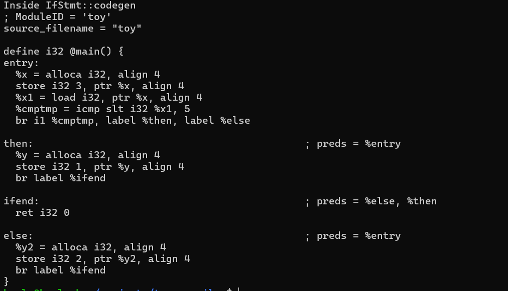
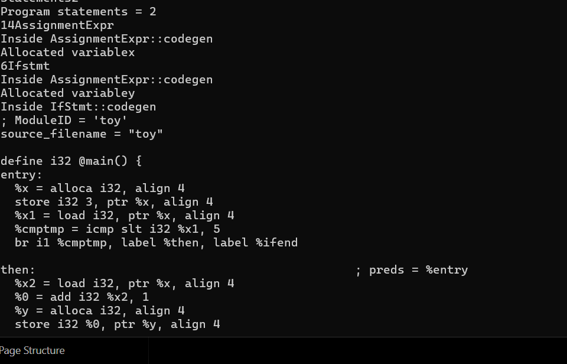
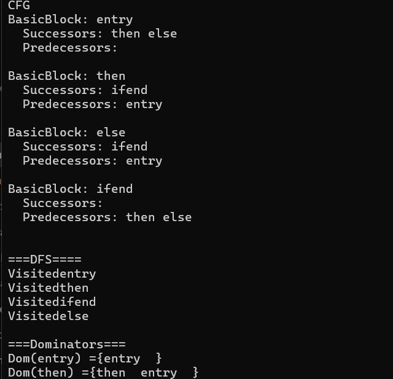

# Toy Compiler: From AST to SSA

A compiler implementation in C++ exploring the stages of a compiler pipeline, from lexical analysis and parsing to LLVM IR generation and control-flow analysis.

The project is an exercise in understanding compiler internals by implementing the underlying data structures and algorithms rather than treating compilation as a black box.

**Current focus:** Control-flow analysis, dominators, dominance frontiers and Static Single Assignment (SSA) construction.

> **Status:** Work in progress. Features and implementation details are evolving.

---

## Overview

The current compiler pipeline:

```text
Source Program
      |
      v
   Lexer
      |
      v
   Parser
      |
      v
 Abstract Syntax Tree (AST)
      |
      v
Semantic Analysis
      |
      v
 LLVM IR Generation
      |
      v
 Control Flow Graph (CFG)
      |
      v
 Dominator Analysis
      |
      v
 Dominator Tree
      |
      v
 Dominance Frontiers
      |
      v
  Phi Placement
      |
      v
 Variable Renaming
      |
      v
  SSA Representation
```

## Implemented Components

| Component | Description |
|---|---|
| Lexer | Tokenizes source programs |
| Parser | Constructs an AST from tokens |
| AST | Represents expressions and statements |
| Semantic Analysis | Performs semantic checks using symbol and scope information |
| LLVM IR Generation | Lowers AST constructs into LLVM IR |
| Basic Blocks | Represents units of straight-line execution |
| Control Flow Graph | Models basic blocks and their control-flow relationships |
| DFS | Traverses the CFG |
| Dominator Analysis | Computes dominator sets |
| Immediate Dominators | Identifies immediate dominators |
| Dominator Tree | Represents the immediate-dominator relationships |
| Dominance Frontiers | Identifies control-flow join points |
| Phi Placement | Inserts phi nodes at relevant join points |
| SSA Renaming | Assigns unique versions to variable definitions |

*Implementation and testing status of individual analysis passes is still being refined.*

## Compiler Internals

### 1. Lexical Analysis and Parsing

The lexer converts source text into tokens, which are consumed by the parser to construct an Abstract Syntax Tree.

The AST provides a structured representation of the program and separates language syntax from subsequent compiler passes.

### 2. Semantic Analysis

Semantic analysis uses symbol tables and scope information to reason about identifiers and their declarations.

### 3. LLVM IR Generation

AST nodes generate LLVM IR through code-generation methods.

The current implementation uses LLVM constructs such as:

- `alloca` for stack allocation
- `load` for reading values
- `store` for writing values
- Conditional and unconditional branches for control flow

For example, an `if-else` statement generates separate basic blocks for its branches, which eventually converge at a join block.

### 4. Control Flow Graphs

The generated LLVM IR is analyzed to construct a Control Flow Graph.

Each basic block maintains its successors and predecessors, allowing the compiler to reason about possible execution paths.

The CFG is also used for subsequent graph analyses.

### 5. Dominator Analysis

A basic block \(A\) dominates a block \(B\) if every path from the entry block to \(B\) passes through \(A\).

The project explores:

- Dominator set computation
- Immediate dominators
- Dominator tree construction
- Dominance frontier computation

These concepts form the foundation for SSA construction.

### 6. Static Single Assignment (SSA)

SSA is an intermediate representation in which each variable is assigned exactly once.

The implementation explores the relationship between dominance information and SSA construction:

1. Compute dominance frontiers.
2. Identify locations requiring phi nodes.
3. Insert phi nodes for variables with multiple reaching definitions.
4. Rename variable definitions using the dominator tree.

---

## Examples and Output

### LLVM IR: Conditional Control Flow

The following example illustrates the generated LLVM IR for an `if-else` statement.

**If-else construction**



**If construction without an else branch**



### CFG, DFS and Dominators

The following output illustrates CFG construction, depth-first traversal and dominator analysis.



For a diamond-shaped control-flow graph:

```text
          entry
          /   \
       then   else
          \   /
          ifend
```

The entry block dominates every reachable block. The `ifend` block has two predecessors, making it an interesting join point for subsequent SSA construction.

---

## Technology Stack

- **Language:** C++17
- **Compiler Infrastructure:** LLVM 18
- **IR / Compiler Infrastructure:** LLVM and MLIR
- **Build System:** CMake
- **Analysis:** Graph algorithms and control-flow analysis

---

## Project Structure

```text
compiler-/
│
├── include/
│   ├── ast/
│   ├── analysis/
│   ├── codegen/
│   ├── lexer/
│   ├── parser/
│   └── semantic/
│
├── src/
│   ├── ast/
│   ├── analysis/
│   ├── codegen/
│   ├── lexer/
│   ├── parser/
│   └── semantic/
│
├── tests/
│
├── main.cpp
├── CMakeLists.txt
└── README.md
```

---

## Building the Project

### Prerequisites

- C++17-compatible compiler
- CMake 3.16 or later
- LLVM 18
- MLIR 18

The current CMake configuration expects LLVM and MLIR to be installed under `/usr/lib/llvm-18`.

### Build

```bash
git clone https://github.com/payal101/compiler-.git

cd compiler-

cmake -S . -B build \
  -DLLVM_DIR=/usr/lib/llvm-18/lib/cmake/llvm \
  -DMLIR_DIR=/usr/lib/llvm-18/lib/cmake/mlir

cmake --build build
```

### Run

```bash
./build/toy
```

The current driver uses an embedded sample program and prints intermediate analysis output and generated LLVM IR.

### Run the Symbol Table Test

```bash
./build/SymbolTableTest
```

---

## Roadmap

- [x] Lexical analysis and parsing
- [x] AST construction
- [x] Semantic analysis and symbol tables
- [x] LLVM IR generation
- [x] Basic block and CFG construction
- [x] DFS traversal
- [x] Dominator analysis
- [x] Immediate dominators and dominator tree
- [x] Dominance frontiers
- [ ] Validate phi-node placement across more complex control-flow graphs
- [ ] Validate SSA renaming, including loops and nested control flow
- [ ] Add an SSA verification pass
- [ ] Explore SSA-based optimizations
- [ ] Improve test coverage and build portability

---


--

**This project is a work in progress.** The goal is to understand how compiler representations and analyses fit together, from source-level syntax to intermediate representations and control-flow transformations.
